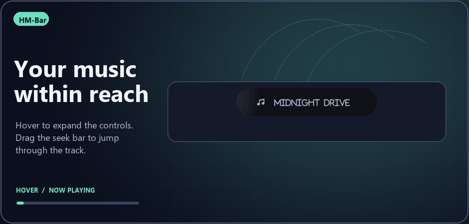
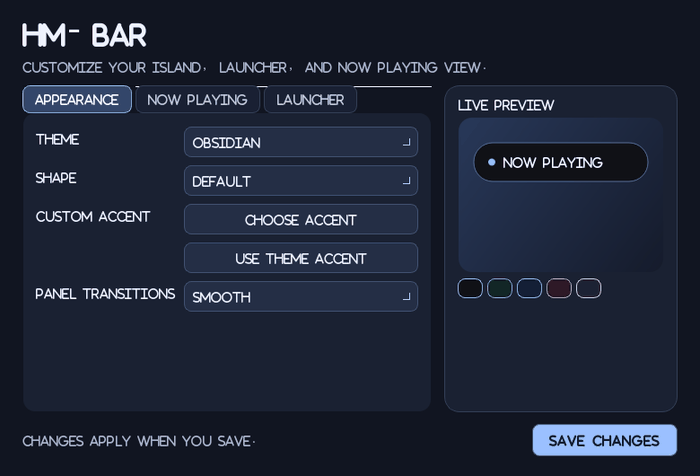

# HM-Bar

HM-Bar is an animated desktop island for Windows. It puts music controls, a focus timer, useful system information, and an app launcher at the top of your screen. It can also display the status and recent transfers of phones connected to **AirPad for Windows**.



## Quick start

**Download for Windows x64** from the [latest release](https://github.com/abdullah120230053-star/HM-Bar/releases/latest). Put both executables in the same folder and open `HM-Bar.exe`.

**Build on Windows x64** with Python 3.11 and [uv](https://docs.astral.sh/uv/). Run these commands in PowerShell from the repository folder:

```powershell
uv venv --python 3.11 .venv
uv pip install --python .venv\Scripts\python.exe -r requirements.txt
.\.venv\Scripts\python.exe main.py
```

To build portable executables, run `powershell -ExecutionPolicy Bypass -File .\build_exe.ps1`. Open `dist\HM-Bar.exe`. Keep `HM-Bar-Settings.exe` beside it so the Settings launcher works.

| Gesture | Action |
| --- | --- |
| Hover | Expand the current panel. |
| Scroll | Switch panels. |
| Double-click | Open the animated app grid. |
| Middle-click | Open the optional clipboard history. |
| Right-click | Open settings, toggle lyrics, or quit. |
| Ctrl+H | Hide or restore the island. |

## Features

- **Music:** Spotify priority, album artwork, optional synced lyrics, playback controls, and a seek bar for players that expose a Windows playback timeline.
- **Workspace:** Focus timer, autosaving notes, and a shelf for files, images, and links you drop onto the island.
- **Panels:** Weather, calendar and tasks, month progress, CPU and memory, storage, network, and quick Windows shortcuts.
- **Desktop tools:** Color picking, screen OCR, a manual meeting timer, window snapping on unscaled displays, battery estimates, privacy activity indicators, and Git, npm build, and Docker status when the relevant tools are installed.
- **Appearance:** Five themes, custom accent colors, an edge-attached Notch Nook, artwork and launcher animation, and adjustable panel motion.



## Connect with AirPad

1. Open **AirPad for Windows** and HM-Bar on the same PC.
2. Scan AirPad's usual pairing QR on your phone, or reconnect an already paired phone.
3. Double-click HM-Bar and choose **AirPad**. The phone appears once it connects through AirPad's desktop companion.

The AirPad panel lets you open received files, add them to the shelf, and explicitly offer a selected file or clipboard item to the connected phone. AirPad handles pairing and acceptance. No second QR code is needed.

Local settings, notes, and shelf data live under `%LOCALAPPDATA%\DynamicIslandPro`. Clipboard history is opt-in and held in memory. Weather and lyrics may require internet access. See the [full guide](PRO.md) for usage and limitations.

## Contributing and credits

When reporting an issue, include your Windows version, the panel or action involved, and steps to reproduce. For changes, run HM-Bar and Settings separately and try the affected flow. For AirPad changes, check the Windows companion and a paired phone.

HM-Bar is based on [rajsriv/dynamic-island-for-windows](https://github.com/rajsriv/dynamic-island-for-windows) at commit `b4bce08`. The upstream README identifies the project as MIT and links to a license file that was absent from the source checkout. The animated demos use sample media.
